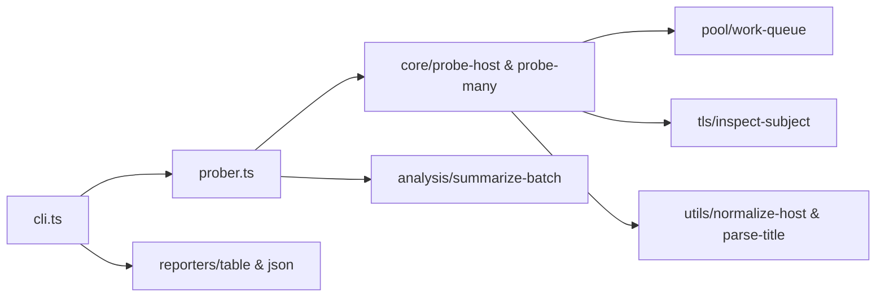

# hx-alive-cli — architecture

## Purpose

Accepts hostnames (CLI argument, file, or stdin), performs concurrent HTTPS liveness
probes, and returns structured results for terminals or JSON pipelines. Non-goals: full
crawler, vulnerability scanning, or unauthenticated port sweeps beyond HTTPS.

## High-level flow

## Module map

| Path                              | Responsibility                                  |
| --------------------------------- | ----------------------------------------------- |
| `src/cli.ts`                      | `probe` and `batch` commands, flags, exit codes |
| `src/prober.ts`                   | Public re-export of `probeHost` / `probeMany`   |
| `src/types.ts`                    | `ProbeResult` and shared probe types            |
| `src/core/probe-host.ts`          | Single-host HTTPS fetch, metadata, TLS CN       |
| `src/core/probe-many.ts`          | Batch orchestration over the work queue         |
| `src/pool/work-queue.ts`          | Concurrency-limited worker pool                 |
| `src/tls/inspect-subject.ts`      | Certificate subject / peer inspection           |
| `src/utils/normalize-host.ts`     | Host string normalization                       |
| `src/utils/parse-title.ts`        | HTML `<title>` extraction                       |
| `src/analysis/classify-status.ts` | HTTP status bucketing                           |
| `src/analysis/summarize-batch.ts` | Aggregate stats for batch JSON                  |
| `src/reporters/table.ts`          | Terminal row formatting                         |
| `src/reporters/json.ts`           | JSON report envelope                            |

## Extension

1. Add probe metadata in `core/probe-host.ts` (keep network I/O here).
2. Extend `analysis/` or reporters for new output shapes.
3. Register new CLI flags in `cli.ts` only when user-facing.
4. Add unit tests with mocked HTTP/TLS — no live network in `*.spec.ts`.
5. Run `npm test` and `npm run format:check`.

## Testing strategy

- **Unit**: `*.spec.ts` under `analysis/`, `core/`, `pool/`, `reporters/`, `utils/` —
  mocked I/O.
- **Integration**: `jest.integration.config.js` — optional live host probes; not
  required in default CI.

## Ethics & scope

Authorized engagements only. See [SECURITY.md](./SECURITY.md).
